# ДЗ 4. Обеспечение отказоустойчивости средствами Apache ZooKeeper

Курс «Инженерия данных», ИТМО. Выполнил: Баранов Владимир Александрович, 407921, J3313. 10 ноября 2026.

Я поднял ансамбль из трёх серверов ZooKeeper 3.9.6 на своём ноутбуке (macOS, Apple Silicon) и встроил его в расчёт пар навыков из ДЗ 3. Две копии координатора выбирают лидера через ZooKeeper, ведут чекпоинт и публикуют результат через узел-указатель. Лидера я замораживал посреди расчёта (`SIGSTOP`) и размораживал после того, как запасной координатор закончил работу. Все выводы ниже сняты с реальных запусков: журналы лежат в `logs/`, тексты команд в `outputs/`, снимки экрана в `report/img/`.

## Итог по критериям

| Что требуется | Результат | Где смотреть |
|---|---|---|
| Ансамбль из трёх серверов, роли | zk2 лидер, zk1 и zk3 последователи | §2.2, `outputs/stage2_ensemble.txt` |
| Без одного сервера работает | остановлен лидер zk2, лидером стал zk3, запись и чтение прошли | §2.3 |
| Без двух не работает | zk1 один: `not currently serving requests`, zkCli не подключился за 20 с | §2.4 |
| Эфемерный узел исчезает с сессией | окно закрыто в 12:41:43, узла нет через 29 с (тайм-аут сессии zkCli 30 с) | §2.6, `outputs/stage2_ephemeral.txt` |
| Без защиты: две записи, указатель версии 2 | две строки «ЗАПИСАЛ РЕЗУЛЬТАТ», `dataVersion = 2` | §4, `logs/stage3-no-fencing/` |
| С защитой: BadVersionError, указатель от запасного | `ПУБЛИКАЦИЯ ОТКЛОНЕНА: BadVersionError`, `dataVersion = 1`, писал B | §5, `logs/stage4-fencing/` |
| Результаты совпали с ДЗ 3 | 7 124 пары, сумма частот 39 256, отпечаток `1f165b4be04d5005`, файл совпал байт в байт | §4, §5 |
| Время смены лидера | 10,89 с без защиты и 11,20 с с защитой | §6 |
| Ответы на два вопроса | | §7 |

## 1. Установка и подготовка

- **Java 17.** Системная Java на ноутбуке 21-я, поэтому рядом поставил Temurin 17.0.21+9: tar.gz с api.adoptium.net, SHA-256 сверен, распакован в `~/Library/Java/JavaVirtualMachines` (без sudo). `JAVA_HOME` задаётся в `zookeeper/env.sh` через `/usr/libexec/java_home -v 17`, и все скрипты запускают ZooKeeper на 17-й Java.
- **ZooKeeper 3.9.6.** На основном зеркале Apache уже лежит только 3.9.7, поэтому архив `apache-zookeeper-3.9.6-bin.tar.gz` (22,9 МБ) взят с archive.apache.org. SHA-512 совпал с официальным `.sha512`. Архив распакован три раза: `zookeeper/zk1`, `zk2`, `zk3`.

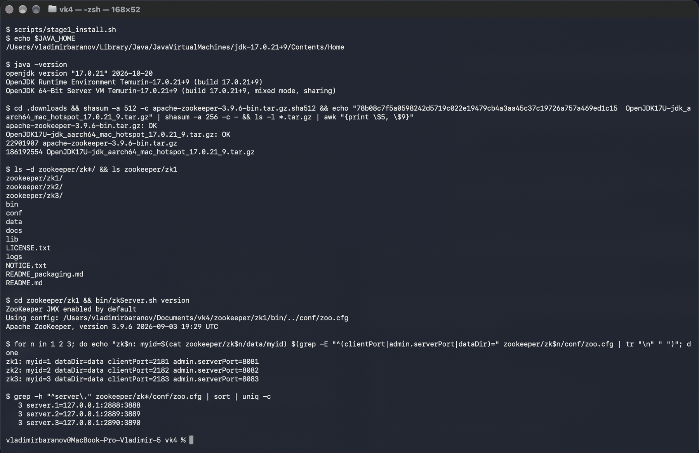

## 2. Ансамбль ZooKeeper

### 2.1. Конфигурации

У каждой копии свой `conf/zoo.cfg`. Строки `server.N` во всех трёх файлах одинаковые, остальное своё:

| Копия | `myid` | `clientPort` | `admin.serverPort` | `dataDir` |
|---|---|---|---|---|
| zk1 | 1 | 2181 | 8081 | `zookeeper/zk1/data` |
| zk2 | 2 | 2182 | 8082 | `zookeeper/zk2/data` |
| zk3 | 3 | 2183 | 8083 | `zookeeper/zk3/data` |

```
tickTime=2000
initLimit=10
syncLimit=5
dataDir=data
clientPort=2182
admin.serverPort=8082
4lw.commands.whitelist=srvr,stat,mntr,ruok,conf
server.1=127.0.0.1:2888:3888
server.2=127.0.0.1:2889:3889
server.3=127.0.0.1:2890:3890
```

Все три сервера на одной машине, поэтому порты для обмена с лидером (2888–2890) и для выборов (3888–3890) тоже разные. `admin.serverPort` пришлось задать явно: встроенный HTTP-сервер по умолчанию слушает 8080, и вторая копия не смогла бы его занять. `dataDir=data` — путь относительно папки копии, сервер запускается из неё (`zookeeper/zk.sh` делает `cd zookeeper/zkN && bin/zkServer.sh …`). В `data/myid` лежит номер сервера: по нему сервер находит свою строку `server.N`.

### 2.2. Роли

Серверы запущены штатной командой `bin/zkServer.sh start`, роли смотрел через `bin/zkServer.sh status`. Лидером выбран zk2, zk1 и zk3 стали последователями.

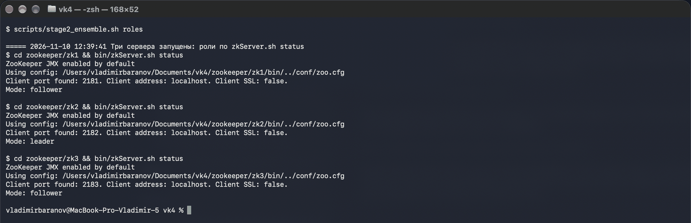

### 2.3. Остановлен один сервер

Остановил лидера zk2 (12:39:51). Оставшиеся два сервера сразу выбрали нового лидера: zk3 стал `leader`, а zk1, по журналу сервера, переключился на него за 216 мс (`FOLLOWING - LEADER ELECTION TOOK - 216 MS`). Ансамбль работает: узел `/stage2-check` записан через zk1 и прочитан через zk3.

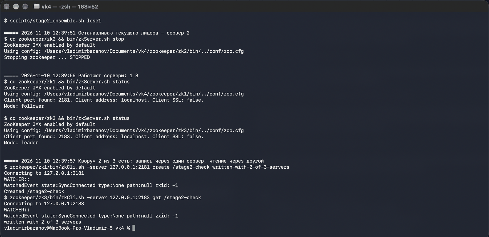

### 2.4. Остановлен второй сервер

Остановил и нового лидера zk3 (12:40:01). Остался zk1, один из трёх, и кворума нет. `zkServer.sh status` отвечает `Error contacting service. It is probably not running.`, хотя процесс жив, а на `srvr` сервер говорит `This ZooKeeper instance is not currently serving requests`. zkCli с `-waitforconnection` за 20 с так и не подключился.

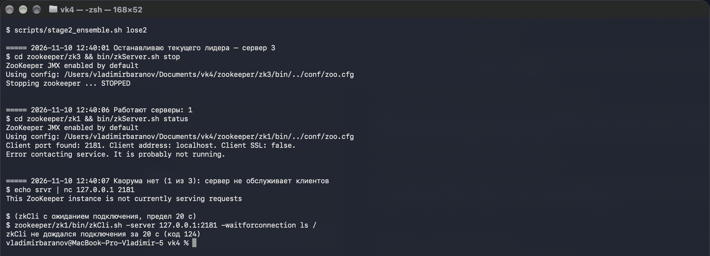

### 2.5. Повторный запуск

Запустил zk2 и zk3 снова (12:40:29). Лидером стал zk1. В его журнале `LEADING - LEADER ELECTION TOOK - 28166 MS`: столько он сидел без кворума в поиске лидера. Узел `/stage2-check`, записанный при двух серверах, на месте.

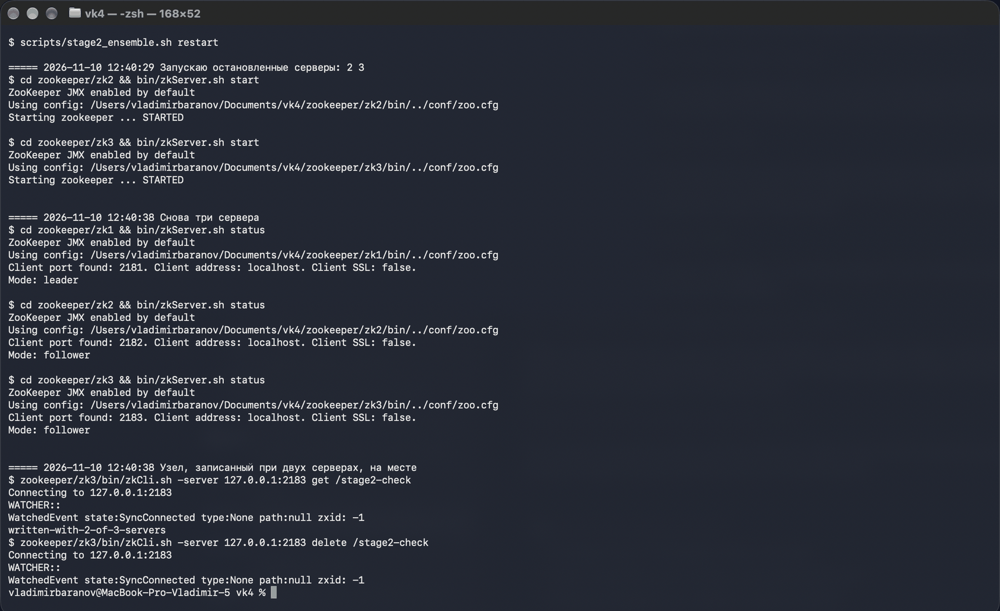

### 2.6. Эфемерный узел

`scripts/stage2_ephemeral.sh` открывает второе окно Terminal с интерактивным `zkCli.sh -server 127.0.0.1:2181` и вводит в нём `create -e /ephemeral-demo created-from-window-2`, потом `get -s`. У узла `ephemeralOwner = 0x1000078eb6a0000`, это id сессии второго окна (тайм-аут 30 с).

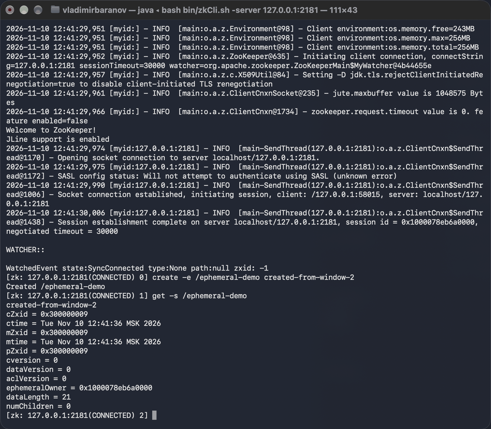

Из первого окна, через другой сервер (zk2) и в другой сессии, узел виден с тем же владельцем. Потом второе окно закрыто. При закрытии окна Terminal шлёт процессу SIGHUP; скрипт делает это явно (`kill -HUP` процессу zkCli) и закрывает окно, чтобы не всплыл диалог «завершить процессы?». Клиент пропал, не закрыв сессию, поэтому сервер ждёт её тайм-аут. Узел был виден ещё 25 с, а через 29 с после закрытия окна исчез. В журнале сервера zk1 в 12:42:09,887: `Expiring session 0x1000078eb6a0000, timeout of 30000ms exceeded`. Если выйти из zkCli командой `quit`, сессия закрывается сразу, и узел пропадает мгновенно.

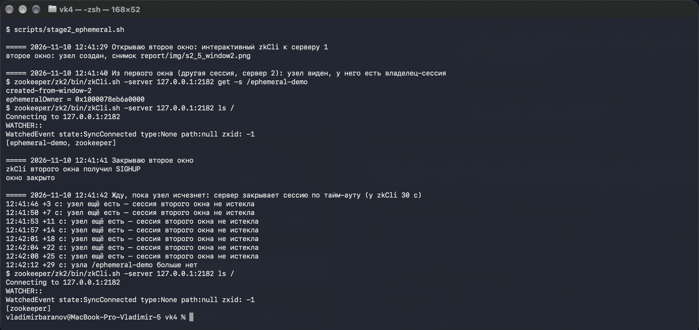

## 3. Координатор: как он устроен

Расчёт взят из ДЗ 3 без изменений. Модули `hw/` (правила варианта Go, чтение сплитов CSV из RustFS Range-запросами, map-таск, подсчёт навыков, пар и троек) скопированы как есть, и совпадение файлов проверено (`outputs/hw3_copy_check.txt`). Данные те же: `s3://hh-lake/raw/it_vacancies_2024.csv` (847 619 384 байта) в RustFS из ДЗ 3. Координатор делит объект на 26 сплитов по 32 МиБ, для каждого вызывает `mapreduce.run_map_task` из ДЗ 3 и берёт из результата пары навыков.

Сверху добавлен ZooKeeper (`coordinator.py`, клиент kazoo, тайм-аут сессии 10 с). Узлы запуска лежат под `/hw4/<run>`:

| Узел | Зачем |
|---|---|
| `election/` | очередь кандидатов: эфемерные последовательные узлы (рецепт `Election` из kazoo). Лидер — у кого номер меньше, остальные следят за предшественником |
| `epoch` | счётчик эпох. Новый лидер увеличивает его через CAS, и номер эпохи равен версии узла: первый лидер получает эпоху 1, следующий 2 |
| `done/split-NNNN` | чекпоинт: сплит посчитан, частичный итог лежит в RustFS (`work/hw4/<run>/split-NNNN.json`) |
| `result` | указатель на результат: JSON со ссылкой на CSV в RustFS, эпохой и автором. Создаётся пустым (версия 0), каждая публикация увеличивает версию |

Как работает лидер:

1. увеличивает эпоху;
2. читает `done/` и считает только сплиты без отметки, поэтому запасной продолжает с чекпоинта;
3. после каждого сплита кладёт частичный итог в RustFS и создаёт отметку в `done/`;
4. в конце складывает 26 частичных итогов, сверяет результат с `pairs.csv` из ДЗ 3 и публикует указатель:
   - **без защиты** (`FENCING=0`): `setData(/result)` без условий;
   - **с защитой** (`FENCING=1`): транзакция `multi` из `check(/epoch, моя_эпоха)` и `setData(/result)`. Если эпоха сменилась, транзакция целиком откатывается с `BadVersionError`.

Чтобы лидера можно было приостановить посреди расчёта, после каждого сплита стоит пауза `SPLIT_DELAY=1.5` с (имитация тяжёлого расчёта). Без неё 26 сплитов и сборка результата занимают 5,1 с (отдельный запуск одного координатора, `logs/timing-no-delay/`), с ней примерно 47 с. Сам расчёт от паузы не меняется.

Отметки в чекпоинте идемпотентны: повторное `create` даёт `NodeExistsError`, и зомби-лидер их не испортит. Не идемпотентна только публикация результата, поэтому защиту по эпохе, как и требует задание, я поставил на неё. На реакцию на потерю сессии координатор намеренно не опирается: почему это не спасает, объясняю в §7.

Сценарий этапов 3 и 4 автоматизирован в `scripts/failover.py`:

1. запускается A; когда он стал лидером, запускается B;
2. когда в чекпоинте 8 из 26 сплитов, лидер получает `SIGSTOP`. Процесс замирает целиком, вместе с потоком, который шлёт пинги ZooKeeper;
3. сценарий засекает, когда B стал лидером, и находит в журнале сервера строку об истечении сессии A;
4. ждёт, пока B доделает расчёт и выйдет, и посылает A `SIGCONT`;
5. проверяет указатель, число записей и совпадение результата с ДЗ 3.

## 4. Этап 3: приостановка лидера без защиты

Запуск `stage3-no-fencing`, журналы в `logs/stage3-no-fencing/`.

| Время | Событие |
|---|---|
| 12:47:54.533 | A стал лидером, эпоха 1; B встал в очередь |
| 12:48:09.034 | `SIGSTOP` лидеру A, в чекпоинте 8 из 26 сплитов |
| 12:48:19.887 | журнал zk1: `Expiring session 0x3000078eeda0004, timeout of 10000ms exceeded` (сессия A) |
| 12:48:19.921 | B стал лидером, эпоха 2, через **10,89 с** после приостановки A |
| 12:48:20.021 | B: «продолжаю с чекпоинта: готово 8 из 26 сплитов, осталось 18» |
| 12:48:52.423 | B: сверка с ДЗ 3 — совпадает байт в байт (7 124 пары, сумма 39 256, отпечаток `1f165b4be04d5005`) |
| 12:48:52.450 | B: **ЗАПИСАЛ РЕЗУЛЬТАТ**, `/result` версия 1 (эпоха 2) |
| 12:48:53.695 | `SIGCONT` лидеру A, он был заморожен 44,7 с |
| 12:48:53.714 | A: `Session has expired`, состояние LOST |
| 12:48:55.767 | A: сверка с ДЗ 3 — совпадает |
| 12:48:55.806 | A: **ЗАПИСАЛ РЕЗУЛЬТАТ**, `/result` версия 2 (эпоха 1) |

После разморозки A дочитал свой сплит 9. Отметка о нём уже была (её поставил B), остальные сплиты тоже отмечены, так что A сразу перешёл к сборке и публикации и переписал указатель. В итоге `dataVersion = 2`, и указатель смотрит на `pairs-epoch1-A.csv` от старого лидера, хотя лидер в эпохе 2 — B. Здесь данные одинаковые, потому что расчёт детерминированный. Но старый лидер затёр запись нового, и с другими данными это была бы порча результата.

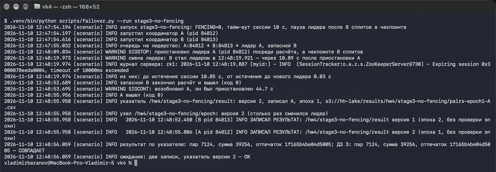

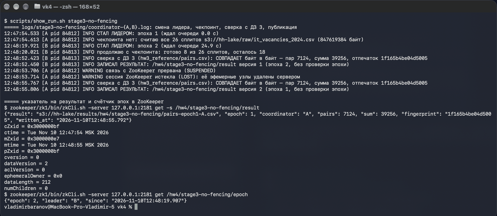

## 5. Этап 4: приостановка лидера с защитой по эпохе

Запуск `stage4-fencing` с `FENCING=1` у обоих координаторов, журналы в `logs/stage4-fencing/`.

| Время | Событие |
|---|---|
| 12:49:08.102 | A стал лидером, эпоха 1; B встал в очередь |
| 12:49:22.717 | `SIGSTOP` лидеру A, в чекпоинте 8 из 26 сплитов |
| 12:49:33.891 | журнал zk1: `Expiring session 0x2000078eb660010, timeout of 10000ms exceeded` (сессия A) |
| 12:49:33.921 | B стал лидером, эпоха 2, через **11,20 с** после приостановки A |
| 12:49:34.037 | B: «продолжаю с чекпоинта: готово 8 из 26 сплитов, осталось 18» |
| 12:50:06.413 | B: **ЗАПИСАЛ РЕЗУЛЬТАТ**, `/result` версия 1 (эпоха 2, проверка эпохи пройдена) |
| 12:50:07.670 | `SIGCONT` лидеру A, он был заморожен 45,0 с |
| 12:50:07.676 | A: `Session has expired`, состояние LOST |
| 12:50:09.552 | A: **ПУБЛИКАЦИЯ ОТКЛОНЕНА: BadVersionError** — моя эпоха 1 устарела, текущая эпоха 2 (лидер B); указатель не изменён |

Результат остался один: `dataVersion = 1`, указатель на `pairs-epoch2-B.csv`, автор B, эпоха 2. Результат по указателю совпадает с ДЗ 3: 7 124 пары, сумма 39 256, отпечаток `1f165b4be04d5005`. Свой CSV A тоже посчитал, он лежит в `results/stage4-fencing/pairs-epoch1-A.csv`, но опубликовать его A не смог.

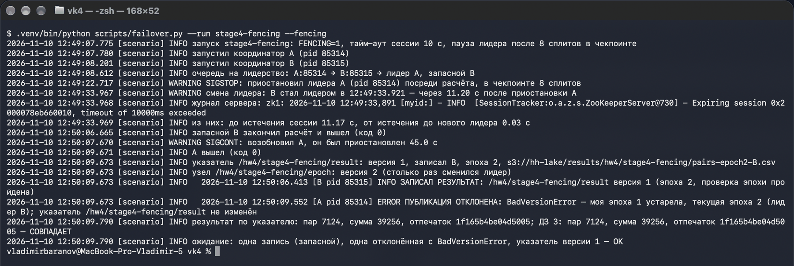

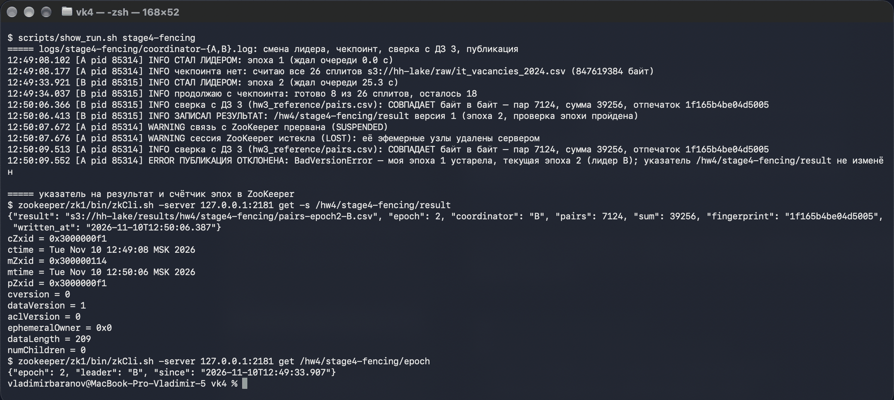

## 6. Время смены лидера

Время меряю от `SIGSTOP` лидеру до строки «СТАЛ ЛИДЕРОМ» в журнале запасного. Обе отметки ставятся на одной машине по одним часам.

| Запуск | `SIGSTOP` | Истечение сессии A (журнал zk1) | B стал лидером | От паузы до истечения | От истечения до нового лидера | Итого |
|---|---|---|---|---|---|---|
| stage3-no-fencing | 12:48:09.034 | 12:48:19.887 | 12:48:19.921 | 10,85 с | 0,03 с | **10,89 с** |
| stage4-fencing | 12:49:22.717 | 12:49:33.891 | 12:49:33.921 | 11,17 с | 0,03 с | **11,20 с** |

Почти всё время уходит на тайм-аут сессии: 10 с. Сверх него набегает до одного `tickTime` (2 с), потому что сервер проверяет истёкшие сессии не постоянно, а на границах тиков. Это видно по журналу: все истечения пришлись на ...:19.887, ...:33.891, то есть на одну и ту же фазу двухсекундного такта. Когда ZooKeeper удаляет эфемерный узел A, запасной получает уведомление (watch на узел предшественника в очереди) и становится лидером за 30 мс. Ускорить смену лидера можно только меньшим тайм-аутом сессии, но тогда лидера будут чаще ошибочно снимать из-за коротких пауз GC и сетевых задержек.

## 7. Ответы на вопросы

### Почему серверов три, а не два и не четыре

ZooKeeper принимает любое решение (выбор лидера, каждую запись) только когда его подтвердило большинство ансамбля: кворум из N/2 + 1 серверов (N/2 с округлением вниз).

| Серверов | Кворум | Сколько отказов переживает |
|---|---|---|
| 1 | 1 | 0 |
| 2 | 2 | 0 |
| 3 | 2 | 1 |
| 4 | 3 | 1 |
| 5 | 3 | 2 |

Два сервера хуже одного. Кворум у них 2, значит при отказе любого ансамбль встаёт: это ровно то, что было на этапе 2, когда остался один живой сервер и он перестал обслуживать клиентов. Точек отказа при этом стало две вместо одной.

Четыре сервера переживают тот же один отказ, что и три, а каждая запись ждёт подтверждения уже от трёх серверов, а не от двух, то есть пишется медленнее и стоит лишнего железа. Хуже того, если сеть разрежет четыре сервера пополам 2 + 2, большинства нет ни у одной половины, и встаёт весь ансамбль. У трёх серверов любой разрыв даёт 2 + 1, и половина из двух продолжает работать.

Поэтому ансамбль делают нечётным: три — минимум, который вообще переживает отказ сервера, пять — если надо пережить два.

Почему нужно именно большинство: любые два большинства пересекаются хотя бы по одному серверу. Поэтому не бывает двух лидеров сразу в двух половинах разорванной сети. И любая подтверждённая запись есть хотя бы на одном сервере любого будущего кворума, так что новый лидер её не потеряет. На этапе 2 это видно: узел, записанный при двух серверах из трёх, после возвращения остальных остался на месте.

### Почему защиту по эпохе проверяет получатель записи, а не ZooKeeper

ZooKeeper знает, кто сейчас лидер, но не может остановить того, кто лидером быть перестал. На этапе 3 это хорошо видно по журналу A. Процесс был заморожен 44,7 с, за это время ZooKeeper закрыл его сессию, удалил эфемерный узел и отдал лидерство B. А для самого A времени не прошло: после `SIGCONT` он продолжил с той же строчки кода. Уведомление о потере сессии (LOST) пришло в 12:48:53.714 в другом потоке, а через две секунды, в 12:48:55.806, A всё равно записал результат.

Проверять перед записью «я ещё лидер?» бесполезно. Между проверкой и записью процесс может снова замереть (пауза GC, своп, долгий сетевой запрос, тот же `SIGSTOP`), и ответ устареет раньше, чем запись дойдёт. Эфемерный узел гарантирует только «ты был лидером, когда спрашивал», но не «ты лидер сейчас».

Поэтому решать должен тот, кто запись принимает, и в тот же момент, когда её применяет. Писатель приходит со своей эпохой. Получатель сравнивает её с последней известной ему и отклоняет запись от старой эпохи, причём атомарно с самой записью, иначе между сравнением и записью опять появится окно.

У меня получатель — узел-указатель `/result`, поэтому проверка сделана транзакцией `multi`: `check(/epoch, моя_эпоха)` + `setData(/result)`. Здесь ZooKeeper работает как хранилище, принимающее условную запись, а не как служба выбора лидера. Выбор лидера зомби-лидера A пропустил: тот спокойно дошёл до записи. Остановил его получатель, по версии эпохи: `BadVersionError`.

Если бы результат писался в RustFS или в базу, ZooKeeper эту запись вообще не увидел бы: она идёт мимо него. Тогда проверку эпохи пришлось бы делать там же, в получателе: условный PUT по версии объекта, столбец `epoch` и `UPDATE … WHERE epoch <= :моя_эпоха` и т. п. Роль ZooKeeper — выдать номер эпохи (у меня это версия узла `/epoch`), а сверять его должен тот, кто принимает запись.

## 8. Как воспроизвести

```bash
source zookeeper/env.sh                      # JAVA_HOME = Java 17
zookeeper/zk.sh start all && zookeeper/zk.sh status all
scripts/stage2_ensemble.sh roles             # затем lose1, lose2, restart
scripts/stage2_ephemeral.sh                  # открывает второе окно Terminal (macOS)
uv sync                                      # kazoo, boto3
uv run python scripts/failover.py --run stage3-no-fencing
uv run python scripts/failover.py --run stage4-fencing --fencing
scripts/show_run.sh stage3-no-fencing
```

Нужны RustFS из ДЗ 3 (`docker compose up -d` в его репозитории) и `.env` с ключами доступа к нему (образец — `.env.example`). Снимки экрана сделаны `report/tools/term_shot.sh`: он запускает команду в новом окне Terminal и снимает окно через `screencapture`.

## Состав репозитория

| Путь | Что там |
|---|---|
| `zookeeper/zk{1,2,3}/conf/zoo.cfg`, `zookeeper/zk{1,2,3}/data/myid` | конфигурации трёх серверов (дистрибутив ZooKeeper в git не кладу) |
| `zookeeper/env.sh`, `zookeeper/zk.sh` | Java 17 и обёртка над штатными `zkServer.sh` и `zkCli.sh` |
| `coordinator.py` | координатор: выбор лидера, эпоха, чекпоинт, публикация с защитой и без |
| `hw/`, `config/`, `hw3_reference/` | код расчёта и эталонный `pairs.csv` из ДЗ 3, без изменений |
| `scripts/` | сценарии этапов 1–4 |
| `logs/stage3-no-fencing/`, `logs/stage4-fencing/` | журналы координаторов A и B, журнал сценария, `summary.json` |
| `logs/timing-no-delay/` | один координатор без `SPLIT_DELAY`: сколько длится сам расчёт |
| `logs/zookeeper/zk{1,2,3}.out` | журналы трёх серверов ZooKeeper (выборы лидера, истечения сессий) |
| `outputs/` | выводы команд всех этапов текстом |
| `results/` | CSV с парами навыков, посчитанные координаторами |
| `report/img/` | снимки экрана |

В журналах серверов много строк `Expiring session …, timeout of 30000ms exceeded`. Это сессии моих одиночных вызовов `zkCli.sh -server … <команда>`: в неинтерактивном режиме zkCli выходит, не закрывая сессию, и сервер закрывает её сам по тайм-ауту. Это не ошибка.
